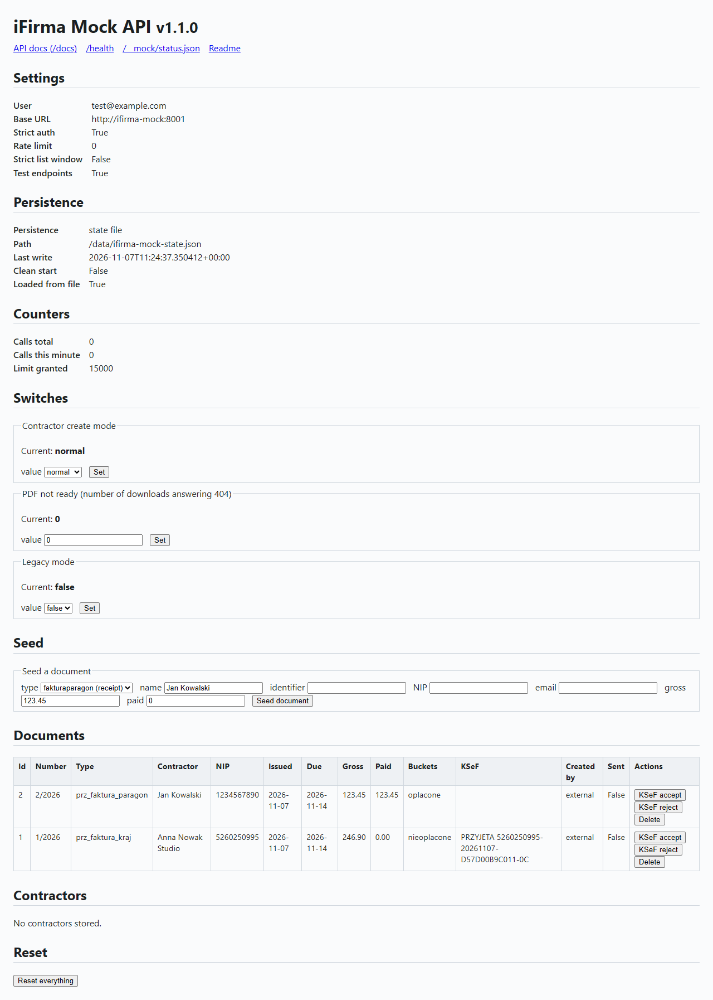

# iFirma MockAPI for testing 

A self-contained test harness for the PrestaShop **`ifirma`** module. It lives at
<https://github.com/SecCodeSmith/test-stack> and is consumed by the iFirma module repo as the
`test-stack` git submodule (clone the module with `--recurse-submodules`) and provides:

- **`ifirma-mock/`** — a **FastAPI** service that mocks the iFirma API and an SMTP sink. It implements
  the exact endpoints the module calls **and validates the module's HMAC-SHA1
  signature**, so signing bugs surface immediately.
- **`docker-compose.yml`** — boots **PrestaShop (pinned, default 9.1.4)** + **MariaDB** + the mock,
  with the module bind-mounted live into PrestaShop.

The module repository's [architecture page](https://github.com/SecCodeSmith/prestashop-integration-with-iFirma/blob/master/docs/architecture.md) describes how the stack and the mock fit the module.

```
test-stack/
├── docker-compose.yml
├── .env.example
├── Makefile
└── ifirma-mock/
    ├── Dockerfile
    ├── requirements.txt / requirements-dev.txt
    ├── app/            # FastAPI app (main, auth, pdf, store, config)
    └── tests/          # pytest suite (also documents the auth contract)
```

## Endpoint parity with the official iFirma API

Verified against the official docs at <https://api.ifirma.pl/>. The mock mirrors
the real endpoints **and response shapes** so the module is tested against realistic
behaviour:

| Purpose | Method & path | Auth key | Response (mock == real) |
|---------|---------------|----------|--------------------------|
| Create receipt | `POST /iapi/fakturaparagon.json` | `faktura` | `{"response":{"Kod":0,"Informacja":"…","Identyfikator":"<string>"}}` — **identifier is a string, no number returned** |
| Create invoice | `POST /iapi/fakturakraj.json` | `faktura` | same envelope as above |
| Undocumented enumeration value | `POST /iapi/fakturaparagon.json`, `POST /iapi/fakturakraj.json` with e.g. `RodzajPodpisuOdbiorcy: "BRK"` (also `LiczOd`, `FormatDatySprzedazy`, `SposobZaplaty`, position `TypStawkiVat`) | `faktura` | Kod 200 "Niepoprawna zawartość żądania - nie można utworzyć obiektu na podstawie zawartości żądania." (observed on the live API 2026-11-02; the field is not named); nothing stored. Absent or `null` fields are not checked |
| Undocumented VAT rate | `POST /iapi/fakturaparagon.json`, `POST /iapi/fakturakraj.json` with a position `StawkaVat` outside `0, 0.05, 0.08, 0.23` (e.g. `0.07`) | `faktura` | Kod 201 `Pozycje[i].StawkaVat: niedozwolona stawka VAT`, nothing stored. **Mock's own message**: the rule is documented, the live wording is unverified. `null` and non-numeric values: `null` is allowed, a string is rejected |
| ZW without PKWiU | same endpoints with a position `TypStawkiVat: "ZW"` and empty/missing `PKWiU` | `faktura` | Kod 201 `Pozycje[i].PKWiU: pole wymagane dla stawki ZW`, nothing stored. **Mock's own message**, documented rule, live wording unverified |
| Incomplete nested contractor | same endpoints with a `Kontrahent` block missing or with an empty `Nazwa` (1–150), `KodPocztowy` (1–16) or `Miejscowosc` (1–65) | `faktura` | Kod 201 `Kontrahent.<Field>: pole wymagane` (also for over-long values), nothing stored. **Mock's own message**, documented rule, live wording unverified. Validated whenever the block is present |
| Download PDF | `GET /iapi/{type}/{id}.pdf` (`?typ=dup` = duplicate) | `faktura` | `application/pdf` bytes; JSON error envelope if not found |
| Register payment | `POST /iapi/faktury/wplaty/{type}/{id}.json` body `{"Kwota":…}` | `faktura` | `{"response":{"Kod":0,"Informacja":"…"}}` |
| List / read number | `GET /iapi/faktury.json?dataOd=…` | `faktura` | `{"response":{"Kod":0,"Wynik":[{"FakturaId":…,"PelnyNumer":"…", …}]}}` |
| List filters | `dataOd` (required, else Kod 201), `dataDo`, `kontrahent`, `nipKontrahenta`, `typ`, `status` (comma list of `oplacone,nieoplacone,oplaconeCzesciowo,przeterminowane`), `strona`, `iloscNaStronie`, `kwotaOd`, `kwotaDo` | `faktura` | Rows have the official key order (`KontrahentNazwa` … `KsefStatus`), no total count. Deleted documents are excluded |
| List filter `kontrahent` | `GET /iapi/faktury.json?dataOd=…&kontrahent=<identifier>` | `faktura` | unknown contractor identifier → Kod 201 "Nie znaleziono kontrahenta o zadanym identyfikatorze" (observed on the live API 2026-11-02, not an empty list); known identifier → filtered rows; empty value → no filter. `nipKontrahenta` stays lenient (unknown NIP → empty list) |
| Document detail | `GET /iapi/{type}/{id}.json` | `faktura` | `{"response":{"Kod":0,"Identyfikator":"…","PelnyNumer":"…","Zaplacono":…,"Uwagi":"…","DodatkoweUwagi":{…},"KsefStatus":"…","KsefNumer":"…", …}}` (the two KSeF fields are empty strings when the document has no KSeF state); unknown/deleted id → Kod 404 envelope (HTTP 200) |
| Send by e-mail | `POST /iapi/{type}/send/{id}.json` body `Tekst`, `SkrzynkaEmailOdbiorcy`, … | `faktura` | Kod 0 "Wiadomość została wysłana." for `fakturakraj`, `fakturawysylka`, `fakturaproformakraj`, … ; `fakturaparagon` → Kod 200 (not available); `Tekst` > 1000 → Kod 201 |
| Send invoice to KSeF | `POST /iapi/{type}/ksef/send/{id}.json` body `{"DataWysylki": null}` (null = send now, `YYYY-MM-DD` = scheduled); `{type}` may be `fakturakraj/korekta`; `{id}` = document id or number with `_` for `/` (e.g. `314_2026`) | `faktura` | Documented request. Response and message wording are the mock's own, unverified live: Kod 0 "Faktura została wysłana do KSeF." (status `WYSLANA`, or `ZAPLANOWANA` when a date is given; `KsefNumer` stays empty); unsupported type → Kod 200; missing key or invalid `DataWysylki` → Kod 201 `DataWysylki: nieprawidłowa wartość`; unknown id → Kod 201 "Nie znaleziono faktury o zadanym identyfikatorze"; already `WYSLANA`, `ZAPLANOWANA` or `PRZYJETA` → Kod 201 "Faktura została już wysłana do KSeF". Every call that names a stored document is counted per document (`ksef_send_calls`), refused or not |
| API usage limit | `GET /iapi/abonent/limit.json` | `abonent` | `{"response":{"Kod":0,"LimitWykorzystany":<calls served today>,"LimitPrzyznany":<day limit, 15000 when none is set>}}` |
| Contractor by id | `GET /iapi/kontrahenci/id/{identifier}.json` | `faktura` | found: `{"response":{"Kod":0,"Informacja":"","Wynik":[<contractor>]}}`; not found: Kod 208 "Nie znaleziono kontrahenta" |
| Create contractor | `POST /iapi/kontrahenci.json` | `faktura` | Kod 0 "Dodano kontrahenta" with `Wynik` = identifier; missing `Nazwa`/`KodPocztowy`/`Miejscowosc` → Kod 201 `Validation errors: …`; identifier > 15 chars or already existing → Kod 201 |
| Replace contractor | `PUT /iapi/kontrahenci/{identifier}.json` | `faktura` | Kod 0 "Zaktualizowano kontrahenta" (full replace, identifier kept); unknown → Kod 208 |
| Search contractors | `GET /iapi/kontrahenci/{phrase}.json` | `faktura` | matches on identifier, `Nazwa` or NIP (max 20) → Kod 0 + `Wynik`; none → Kod 208 "Brak wyników" |
| Document contractor lookup, step 1 | `POST /iapi/fakturaparagon.json`, `POST /iapi/fakturakraj.json` with top-level `IdentyfikatorKontrahenta` | `faktura` | stored identifier (compared after trim, any length) → that contractor is attached, its stored fields win over the `Kontrahent` block; unknown → not an error, continue with step 2 |
| Document contractor lookup, step 2 | same endpoints with top-level `NIPKontrahenta` | `faktura` | digits-only match against stored NIPs (first match attached); unknown → not an error, continue with step 3 |
| Document contractor lookup, step 3 | same endpoints with nested `Kontrahent` | `faktura` | null/empty `Identyfikator` → contractor created from the block with a generated identifier; unknown non-empty `Identyfikator` → Kod 201 "Nie znaleziono kontrahenta o zadanym identyfikatorze", nothing stored |

**Contractor rules.** As in production, a document whose `Kontrahent.Identyfikator` is
non-empty but matches no stored contractor is rejected with Kod 201 "Nie znaleziono
kontrahenta o zadanym identyfikatorze" and nothing is stored. A null or empty identifier
makes the mock create the contractor from the `Kontrahent` block with a generated
identifier (`K000001`, …), which is written back onto the document and shows up as
`IdentyfikatorKontrahenta` in list rows. The top-level lookup keys are tried first (see
the parity table): `IdentyfikatorKontrahenta`, then `NIPKontrahenta`, and only then the
nested `Kontrahent` block. The live API's handling of an `IdentyfikatorKontrahenta`
longer than the documented 15 characters is unverified; the mock accepts it. Documents seeded through `/__mock/documents`
register their contractor when its identifier is new; `POST /__mock/contractors` seeds
one directly (no HMAC) and `/__mock/reset` clears them.

Auth on every call: `Authentication: IAPIS user=<user>, hmac-sha1=<hash>` where
`hash = HMAC-SHA1(url + user + keyName + body, hex2bin(key))` and the URL is signed
**without** its query string.

Two things the audit corrected so the mock is not misleading:

1. **Create returns only the identifier (as a string), never the printable number.**
   The number is assigned server-side and read back from `faktury.json` (under
   `Wynik`, matched on `FakturaId`). The module now does exactly this after issuing a
   document, so the number shown in PrestaShop is obtained the same way as in production.
2. **The list payload uses `Wynik`** (not `Faktury`) with the real field names
   (`FakturaId`, `PelnyNumer`, `Brutto`, `Rodzaj`, `KontrahentNazwa`, …).

## Quick start

```bash
cp .env.example .env          # optional; defaults work out of the box
docker compose up -d --build  # or: make up
```

- PrestaShop back office → http://localhost:8080/admin-dev  (`admin@example.com` / `Passw0rd!`)
- PrestaShop front office → http://localhost:8080
- iFirma mock → http://localhost:8001  (docs at http://localhost:8001/docs)
- SMTP sink → localhost:1025 (messages at http://localhost:8001/__mock/mail)

First PrestaShop boot takes a few minutes while it auto-installs. Follow it with
`make ps-logs`.

## Point the module at the mock

In the PrestaShop back office → **Modules** → install **iFirma – Receipts & Invoices**,
then open its configuration and set:

| Field | Value |
|-------|-------|
| **API base URL** | `http://ifirma-mock:8001/iapi/` |
| **iFirma login** | `test@example.com` |
| **API key: faktura** | `1111111111111111111111111111111111111111111111111111111111111111` |

These must match the `IFIRMA_MOCK_*` values in `docker-compose.yml` (from `.env`).
`ifirma-mock` is the service's hostname on the internal Docker network, which is why
the base URL uses it rather than `localhost`.

> The module signs `baseURL + endpoint` (query excluded). The mock rebuilds the same
> string as `IFIRMA_MOCK_BASE_URL + path`, so `IFIRMA_MOCK_BASE_URL`
> (`http://ifirma-mock:8001`) must equal the module base URL **minus** the `/iapi/` path.

## Test the flow

1. Create a test order in PrestaShop.
2. Open it in the back office → **iFirma** panel → **Create Receipt**.
   The request is signed by the module and verified by the mock; you get a document
   number back.
3. **Download PDF** → the mock returns a generated PDF.
4. **Update status in iFirma** → registers a payment in the mock.
5. Log in as the customer → **My account** / order detail → download the receipt.

Watch the exchange live with `make mock-logs`.

## Run the mock's unit tests (no Docker needed)

```bash
cd ifirma-mock
python -m venv .venv && . .venv/bin/activate      # Windows: .venv\Scripts\activate
pip install -r requirements-dev.txt
pytest
```

The `sign()` helper in the tests reproduces the module's signing algorithm exactly,
so the suite is both a functional test and an executable spec of the auth contract.

## Auth toggles

- `IFIRMA_MOCK_STRICT_AUTH=true` (default) — bad/missing signatures are rejected with
  HTTP 401, like the real API. Set to `false` to accept anything (logs a warning) when
  you just want to smoke-test wiring.

## State file and clean start

The mock keeps its state in one JSON file: the documents, the contractors, the identifier
sequences, the three test switches (see below) and the served-call counter. The per-minute
rate-limit window is not kept, since it has no meaning after a restart. The state is written
after every change to the JSON file named by `IFIRMA_MOCK_STATE_FILE`. In the stack that is
`/data/ifirma-mock-state.json` on the named volume `mock_data`, so `docker compose up -d --build`,
`docker compose restart` and a host reboot keep it, and `make destroy` removes it.

When `IFIRMA_MOCK_STATE_FILE` is empty (the default outside the stack, as in the pytest suite
and a plain `uvicorn` run) the mock keeps everything in memory only and starts empty each time.

For a clean start, run `make up-clean` (or `IFIRMA_MOCK_CLEAN_START=true docker compose up -d --force-recreate ifirma-mock`).
The variable is read at start-up only and discards the stored state first. It is baked into the
container until that container is recreated: a plain `docker compose restart ifirma-mock` after an
`up-clean` starts clean again, and `make up` recreates the container without the flag, so the
state stored from then on is kept.

`POST /__mock/reset` clears the state file as well as the memory, so a restart right after a
reset starts empty.

If the state file cannot be read (invalid JSON, or an unknown `version`), the mock renames it to
`<file>.corrupt-<timestamp>`, starts empty and logs a warning, which shows in `make mock-logs`.
The renamed file is kept, never deleted.

## Status page

Open <http://localhost:8001/__mock/status> to see the mock in a browser. It needs no HMAC
signature, like the other `/__mock/*` routes. The page shows:

- the effective settings (login, signed base URL, strict auth, rate limit, strict list window,
  test endpoints) and the persistence state (state file path or "memory only", time of the last
  write, whether the mock started clean);
- the call counters: authenticated calls served in total and in the current minute, and the limit;
- the three switches (contractor create mode, PDF-not-ready calls remaining, legacy mode), each
  with a form that changes it;
- the stored documents, newest first, with KSeF accept and reject and delete buttons per row;
- the stored contractors.

A form at the top seeds a sample document (document type, contractor, gross and paid amount) through
the same rules as `POST /__mock/documents`. A reset button does what `POST /__mock/reset` does, after
a confirmation. Each action returns to the page with a message.

`GET /__mock/status.json` returns the same data as JSON for scripts. The page, its JSON twin and its
actions are test-only: with `IFIRMA_MOCK_TEST_ENDPOINTS=false` they answer HTTP 404. None of them counts
as an API call, so watching the page never changes the call counter or the simulated rate limit.

The page also has a Mail section: the SMTP port, a form that switches the reject mode on or off, the
messages newest first (time, from, to, bcc, subject, attachments, a link to the raw source) and a
"Clear mailbox" button. `/__mock/status.json` carries the same data as `mail`, `switches.mail_reject`
and `settings.smtp_port`.



## Mail sink (SMTP)

The mock also runs an SMTP listener on port 1025 inside its container. It accepts any sender and any
recipient, with no `AUTH` and no TLS, and answers every message with 250. Messages are kept in memory
only, up to 200 (the oldest is dropped first). The mailbox is empty after a restart and `POST /__mock/reset`
empties it. Nothing is relayed to a real mailbox.

Point a PrestaShop shop at the sink:

| PrestaShop setting | Value |
|--------------------|-------|
| `PS_MAIL_METHOD` | `2` (SMTP) |
| `PS_MAIL_SERVER` | `ifirma-mock` |
| `PS_MAIL_SMTP_PORT` | `1025` |
| `PS_MAIL_SMTP_ENCRYPTION` | `off` |
| `PS_MAIL_USER` | empty |
| `PS_MAIL_PASSWD` | empty |
| `PS_MAIL_TYPE` | `3` (HTML plus text) |

The module's `tests/smoke/run.php` writes these settings itself before it runs, so the shops it tests send their mail here.

Read the mailbox back with these endpoints:

| Method and path | Answer |
|-----------------|--------|
| `GET /__mock/mail` | Listing, newest first: `id`, `received_at`, `from`, `to`, `cc`, `bcc`, `subject`, attachments count, `size`. `bcc` holds the envelope recipients that are in neither `To` nor `Cc`. |
| `GET /__mock/mail/{id}` | One message: the listing fields plus `headers`, `text`, `html`, `envelope`, `attachments` (`filename`, `content_type`, `size`, `sha256`) and `inline` (embedded images such as the shop logo, listed separately from attachments; adds `content_id`). |
| `GET /__mock/mail/{id}/raw` | The raw message as `message/rfc822`. |
| `GET /__mock/mail/{id}/attachments/{index}` | The bytes of one attachment, with its content type. |
| `GET /__mock/mail/{id}/inline/{index}` | The bytes of one embedded (inline) image, with its content type. |
| `DELETE /__mock/mail` | Empties the mailbox. |
| `GET /__mock/mail/reject` | The reject switch: `{"enabled": bool}`. |
| `POST /__mock/mail/reject` | Body `{"enabled": true}` turns the switch on (or `false` off). While on, the listener answers 554 at `DATA` and stores nothing, so the shop records a failed delivery. |

All of these are test endpoints: they answer 404 when `IFIRMA_MOCK_TEST_ENDPOINTS=false`, and none of
them counts as an API call.

### Shop mail lands in the sink

Send a test message from the host, then read the mailbox:

```python
import smtplib
from email.message import EmailMessage

msg = EmailMessage()
msg["From"], msg["To"], msg["Subject"] = "shop@example.test", "customer@example.test", "Test"
msg.set_content("Hello from the host.")
with smtplib.SMTP("localhost", 1025) as smtp:
    smtp.send_message(msg)
```

```bash
curl http://localhost:8001/__mock/mail
```

## Simulating iFirma's own integrator

iFirma's own integrations (shop plugins, marketplaces) create documents the module
did not issue. Seed such "external" documents through the test-only endpoints (no HMAC):

```bash
# create an unpaid external receipt (returns the created list row incl. FakturaId)
curl -X POST http://localhost:8001/__mock/documents -H 'Content-Type: application/json' -d '{
  "doc_type": "fakturaparagon",
  "contractor": {"Nazwa": "Jan Kowalski", "Identyfikator": "JAN1", "NIP": "1234567890", "Email": "jan@example.com"},
  "gross": 123.45, "currency": "PLN", "paid": 0,
  "uwagi": "Zamówienie 42", "created_by": "external"
}'

# delete it again (disappears from lists and detail)
curl -X DELETE http://localhost:8001/__mock/documents/1

# wipe all documents, contractors, call counters, the runtime rate limits and the four switches below, and clear the stored state file
curl -X POST http://localhost:8001/__mock/reset
```

Four switches reproduce iFirma behaviour the module must handle. All are test-only (no HMAC,
disabled with `IFIRMA_MOCK_TEST_ENDPOINTS=false`) and are restored to their defaults by `/__mock/reset`:

```bash
# rename mode: POST /iapi/kontrahenci.json stores the contractor under "IFI" + digits of the sent
# Identyfikator + a 6-digit sequence (PS-C7 -> IFI7000001), so GET .../kontrahenci/id/PS-C7.json
# answers Kod 208, while the create answer still echoes the sent identifier in Wynik.
# A null/empty identifier keeps generating K%06d. Default is "normal".
curl -X POST http://localhost:8001/__mock/contractor-mode -H 'Content-Type: application/json' -d '{"create": "rename"}'
curl http://localhost:8001/__mock/contractor-mode   # {"create": "rename"}

# pdf-not-ready: the next N authenticated GET /iapi/{doc_type}/{id}.pdf calls answer
# {"response": {"Kod": 404, "Informacja": "Nie znaleziono dokumentu <id>."}} (HTTP 200), then the PDF is served again.
curl -X POST http://localhost:8001/__mock/pdf-not-ready -H 'Content-Type: application/json' -d '{"calls": 2}'
curl http://localhost:8001/__mock/pdf-not-ready     # {"remaining": 2}

# legacy mode (off by default): for the upgrade test from 1.0.0 of the module, which sends
# RodzajPodpisuOdbiorcy BRK, a 4-decimal StawkaVat such as 0.2301 and an e-mail as the contractor
# Identyfikator. While on, a new document may carry any RodzajPodpisuOdbiorcy, any StawkaVat and an
# unknown nested Kontrahent.Identyfikator, which the mock then creates under that identifier.
# Every other rule still applies (LiczOd, TypStawkiVat ZW needs PKWiU, required Kontrahent fields,
# non-empty Pozycje). Cleared by /__mock/reset.
curl -X POST http://localhost:8001/__mock/legacy-mode -H 'Content-Type: application/json' -d '{"enabled": true}'
curl http://localhost:8001/__mock/legacy-mode       # {"enabled": true}

# ksef-auto (off by default): behave like an iFirma account that submits invoices to KSeF on its own
# (iFirma can do that at a time set in its settings). While "send", every document created through
# POST /iapi/fakturakraj.json or fakturaparagon.json for a buyer with a NIP is stored with KsefStatus
# WYSLANA; while "accept" it is stored PRZYJETA with a generated KsefNumer. Receipts and invoices for a
# buyer without a NIP, and documents seeded through /__mock/documents, are not touched. No KSeF send
# call is needed or counted. Cleared by /__mock/reset.
curl -X POST http://localhost:8001/__mock/ksef-auto -H 'Content-Type: application/json' -d '{"mode": "send"}'
curl http://localhost:8001/__mock/ksef-auto         # {"mode": "send"}
```

The upgrade test from 1.0.0 mounts the 1.0.0 tree of the module instead of the working tree with
`docker-compose.upgrade-1.0.0.yml` (set `IFIRMA_1_0_0_DIR` to the 1.0.0 worktree path as docker sees it;
the file's header has the exact `docker compose -f ... -f ... up` command).

KSeF status helpers (no HMAC) simulate the outcome of a KSeF submission, which the real
API reports asynchronously. `accept` sets `KsefStatus` to `PRZYJETA` and assigns a mock
`KsefNumer` of the form `<NIP digits or 0000000000>-<YYYYMMDD>-<12 hex>-<2 hex>` (the
format is the mock's own, unverified live); `reject` sets `ODRZUCONA` and leaves the number
empty. Both answer with the list row, and an unknown id gets HTTP 404:

```bash
curl -X POST http://localhost:8001/__mock/ksef/accept/1
curl -X POST http://localhost:8001/__mock/ksef/reject/1
```

Accepted body fields: `doc_type`, `contractor`, `gross` or `Pozycje`, `currency`,
`issue_date`, `sale_date`, `sale_date_format`, `due_date`, `uwagi`, `dodatkowe_uwagi`, `draft`, `paid`, `created_by`
(default `external`), `linked_document`, `ksef_status`, `ksef_number`.

`sale_date` (ISO `YYYY-MM-DD`) is stored as `DataSprzedazy` and `sale_date_format` as
`FormatDatySprzedazy`, both echoed by the detail endpoint. When `sale_date` is absent it
defaults to `issue_date` (or today if that is absent too); `sale_date_format` defaults to `DZN`.

## Rate limits

iFirma allows 100 requests per minute and 15,000 per day per account. The mock simulates both on its
own clock: every authenticated `/iapi/*` call counts in the current calendar minute and the current
calendar day (refused calls count too), and a call over either limit is refused, minute first. A limit
of `0` is "no limit". The compose stack sets `100` and `15000` and the mock's timezone to
`Europe/Warsaw`, so its day matches the shop's.

A refused call is answered with **HTTP 429**, a `Retry-After` header (whole seconds until the refusing
window ends, at least 1) and this body, and has no other effect (a refused create stores nothing, a
refused KSeF send changes no state):

```json
{"response": {"Kod": 100, "Informacja": "Przekroczono limit zapytań (limit minutowy: 100)"}}
```

The window word is `limit minutowy` or `limit dzienny`. The body shape and the 429 are the mock's own
choice (iFirma documents no limit answer), so the module recognises either the status or the phrase.

Test-only routes (no HMAC, `IFIRMA_MOCK_TEST_ENDPOINTS`; restored by `/__mock/reset`):

| Route | Effect |
|-------|--------|
| `GET /__mock/rate-limit` | `per_minute`, `per_day` (in force), `defaults` (from the environment), `calls_this_minute`, `calls_today`, `calls_total`, `rejected_total` (refused calls), `peak_minute` (most calls in any one calendar minute since the last reset) |
| `POST /__mock/rate-limit` | body `{"per_minute": n, "per_day": m}`, either key, non-negative integers; anything else is 422 and changes nothing |
| `POST /__mock/rate-limit/next-window` | body `{"window": "minute"}` or `"day"` clears that window's count as if it had ended (total and the other window untouched); another value is 422 |

```bash
# provoke a refusal after 5 calls in a minute, look at it, and move on without waiting
curl -X POST http://localhost:8001/__mock/rate-limit -H 'Content-Type: application/json' -d '{"per_minute": 5}'
# ... make 6 signed calls; the sixth answers HTTP 429 with Retry-After ...
curl http://localhost:8001/__mock/rate-limit        # "rejected_total": 1, "peak_minute": 6
curl -X POST http://localhost:8001/__mock/rate-limit/next-window -H 'Content-Type: application/json' -d '{"window": "minute"}'
curl -X POST http://localhost:8001/__mock/reset     # limits are back to the environment values
```

The status page shows the limits next to their environment defaults and the counters, and has a form for
both limits plus next-minute and next-day buttons (`/__mock/status.json` carries the same as `rate_limit`).
The limits, the day count and the refused-call total survive a restart (the minute count does not).

## Mock settings

| Variable | Default | Effect |
|----------|---------|--------|
| `IFIRMA_MOCK_RATE_LIMIT` | `0` (off); compose: `100` | When `N > 0`, the (N+1)th authenticated `/iapi/*` call within a calendar minute is refused with HTTP 429, `Retry-After` and Kod 100 "Przekroczono limit zapytań (limit minutowy: N)" (see "Rate limits") |
| `IFIRMA_MOCK_RATE_LIMIT_DAY` | `0` (off); compose: `15000` | The same per calendar day ("limit dzienny"); also the `LimitPrzyznany` of `abonent/limit.json` (15000 when off) |
| `TZ` | image default (UTC); compose: `Europe/Warsaw` | Zone of the mock's calendar day (and of its log timestamps) |
| `IFIRMA_MOCK_TEST_ENDPOINTS` | `true` | Enables `/__mock/*`; when `false` they return HTTP 404 |
| `IFIRMA_MOCK_STRICT_LIST_WINDOW` | `false` | When `true`, `faktury.json` without `dataDo` uses the real API's `dataOd + 30 days` window (off by default so a plain `dataOd=2020-01-01` call still lists new documents) |
| `IFIRMA_MOCK_KEY_ABONENT` | empty | Key for `abonent/limit.json`; empty means that endpoint always answers 401 |
| `IFIRMA_MOCK_STATE_FILE` | empty (memory only) | Path of the JSON file that keeps the mock state across restarts; the compose file sets `/data/ifirma-mock-state.json` on the `mock_data` volume |
| `IFIRMA_MOCK_CLEAN_START` | `false` | When `true`, the mock starts with an empty state and discards the stored one (read at start-up only; see "State file and clean start") |
| `IFIRMA_MOCK_SMTP_PORT` | `1025` | Port of the SMTP sink inside the mock; `0` disables the listener (see "Mail sink (SMTP)") |

## Notes

- The PrestaShop image is pinned: `prestashop/prestashop:${PS_IMAGE_TAG:-9.1.4-apache}`. Test another supported
  version by setting `PS_IMAGE_TAG` (`8.0.5-apache`, `8.1.7-apache`, `8.2.2-apache`, `9.0.3-apache`, `9.1.4-apache`);
  the parent repository's `smoke` workflow runs the smoke scenarios against all of them. Never use `latest`:
  CI rejects unpinned images (`tools/check_pinned_images.py`).
- `make destroy` wipes the DB and PrestaShop volumes for a clean reinstall.
- Because the module folder (repo parent) is bind-mounted, its own `test-stack/`
  appears under `modules/ifirma/test-stack` inside the container — harmless; PrestaShop
  only loads `ifirma.php`.

## Module smoke run

With the stack up and PrestaShop installed, run the module's end-to-end smoke script
inside the PrestaShop container (duplicate guard, data request, delivery, status sync,
cron, customer visibility), from the repository root:

```bash
docker compose -f test-stack/docker-compose.yml exec -u www-data prestashop php modules/ifirma/tests/smoke/run.php
```

Run it as `www-data`: a root-run script leaves root-owned cache directories under `var/cache` and Apache then fails with `unable to create directory`. Repair: `docker compose exec prestashop chown -R www-data:www-data /var/www/html/var`.

It exits non-zero on any failed assertion. It creates real orders in the dev database;
use `make destroy` to reset. Details, environment overrides and limitations are in
`tests/smoke/README.md` of the iFirma module repository (the parent checkout that contains this submodule).

## Legal Disclaimer & Trademarks

iFirma is a registered trademark of IFIRMA SA.

This module is an independent third-party open-source integration and is not officially affiliated with, endorsed by, or sponsored by IFIRMA SA.

The name "iFirma" and associated references are used strictly for identification, nominative reference, and descriptive compatibility purposes (interoperability / prawo cytatu) to inform users about the third-party accounting system with which this PrestaShop module integrates.
